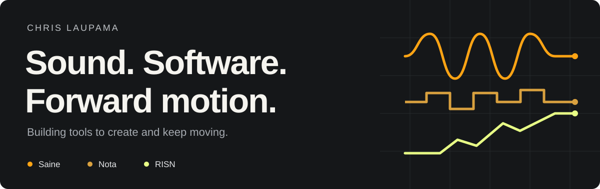
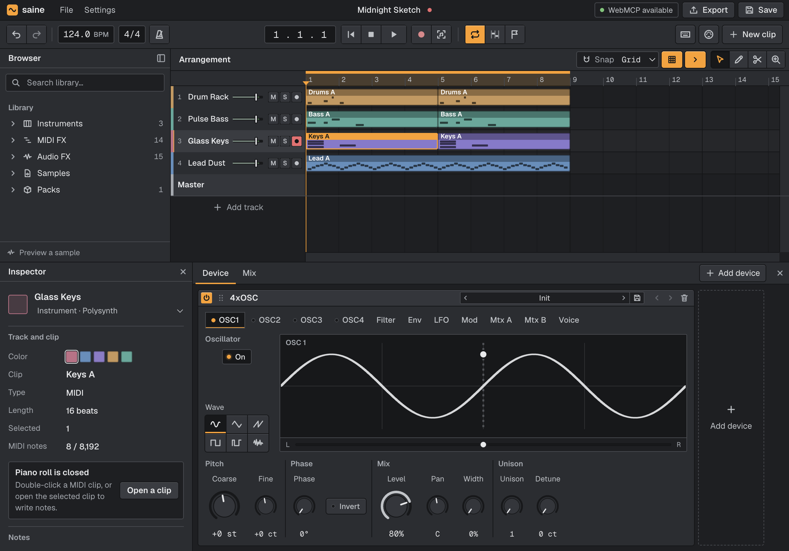
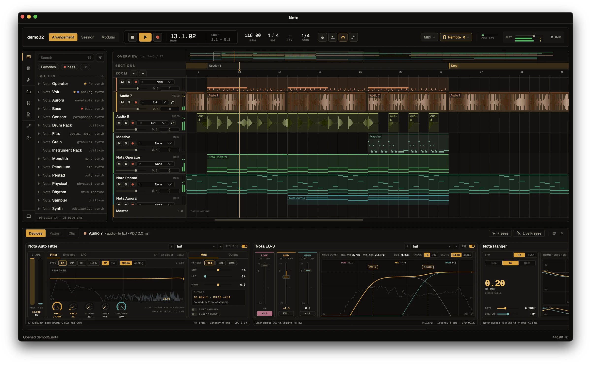
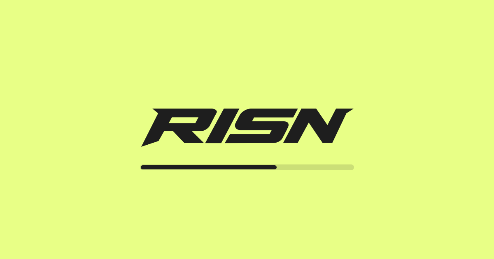

I'm Chris. I build music software, explore what AI can do inside creative tools, and work on making training easier to stick with.

## On my workbench

<table>
  <tr>
    <td width="42%" valign="middle">
      BROWSER MUSIC STUDIO · ALPHA
      <h3><a href="https://www.saine.studio/">Saine ↗</a></h3>
      
From an idea to a track, right in your browser. Audio, MIDI, instruments, effects, and AI collaboration through WebMCP.

      
<a href="https://www.saine.studio/studio/"><b>Open the studio →</b></a>

    </td>
    <td width="58%" valign="middle">
      
    </td>
  </tr>
  <tr>
    <td width="42%" valign="middle">
      DESKTOP MUSIC STUDIO · OPEN SOURCE
      <h3><a href="https://github.com/chrislaupama/nota">Nota ↗</a></h3>
      
A free studio for macOS, Windows, and Linux. Arrangement, clip launching, modular modulation, and plugins. No subscription. No account.

      
<a href="https://github.com/chrislaupama/nota"><b>My work on Nota →</b></a> <a href="https://github.com/nota-daw/nota">Upstream project</a> · <a href="https://nota-daw.github.io/nota-site/">Explore Nota</a>

    </td>
    <td width="58%" valign="middle">
      
    </td>
  </tr>
  <tr>
    <td width="42%" valign="middle">
      TRAINING &amp; COMMUNITY · IN TESTING
      <h3><a href="https://risn.app/">RISN ↗</a></h3>
      
Strength, running, and walking with a plan. Progression for your next session and clubs that keep you showing up. iPhone first.

      
<a href="https://risn.app/"><b>Join early access →</b></a>

    </td>
    <td width="58%" valign="middle">
      
    </td>
  </tr>
</table>

### The thread running through it all

Tools that get out of the way. Interfaces that make sense. More time making music, creating something, or getting a session in.

<a href="https://www.chrislaupama.com"><b>chrislaupama.com ↗</b></a> &nbsp;·&nbsp; <a href="https://github.com/chrislaupama?tab=repositories">Explore my repositories</a>

